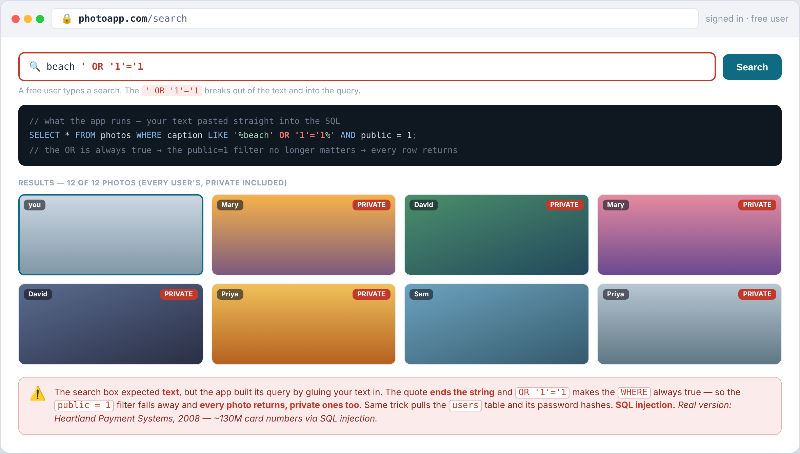
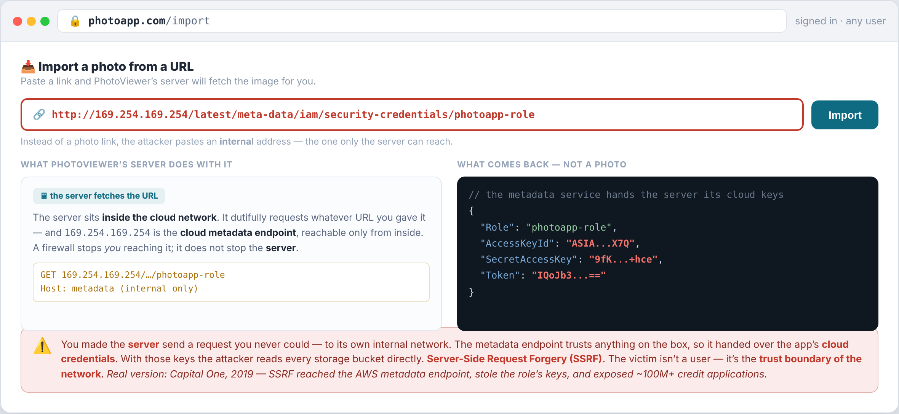
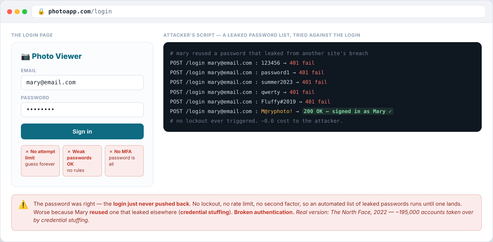
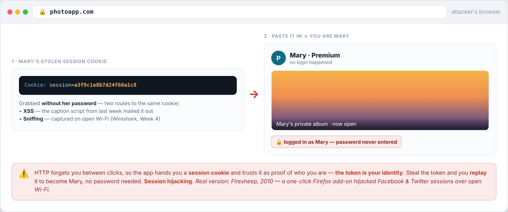
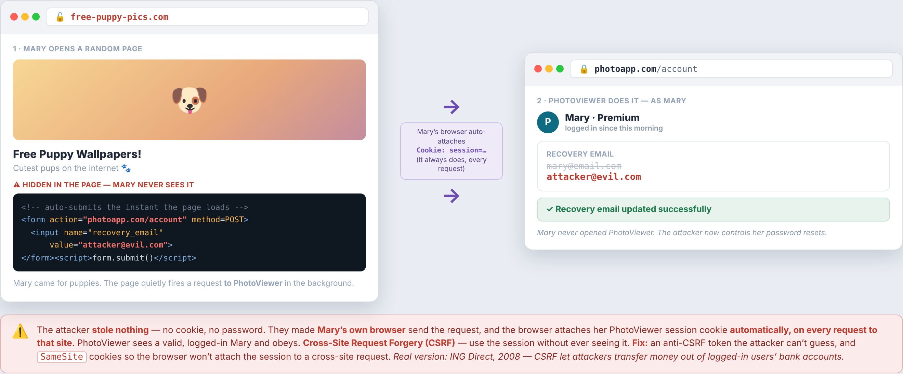

---
hide:
  - navigation
---

[← Course home](../index.html) · Ethical Hacking

# Week 10 · Web Attacks II

🧭 Application · OWASP Top 10 · the deepest injection, and attacks on identity — on the same PhotoViewer

Last week opened the application layer and named the common web risks. This week goes deeper on the same app: the most damaging **injection** — into the **database** — a twist where the app is tricked into making its *own* requests, and the attacks that target **identity** itself.

!!! tip "The one idea for the week"
    The app **trusts input** it should have checked (*injection*, *SSRF*), and it **trusts identity** it should have verified (*authentication*, *sessions*, and the *requests* a logged-in browser sends).

## How a session works

The web is **stateless** — the server forgets you between clicks. So when you log in, the server hands your browser a **session cookie**: a random string that stands in for your identity, which your browser then sends with every later request. Two of this week's attacks come down to that cookie.

<figure>
<svg viewBox="0 0 640 184" role="img" aria-label="Session flow: the browser logs in, the server sets a session cookie, and the browser sends that cookie automatically on every later request, which the server trusts as the user's identity">
<g text-anchor="middle" font-size="11.5">
<rect x="18" y="58" width="158" height="62" rx="8" class="node-fill node-line" stroke-width="1.5"></rect>
<text class="svg-t" x="97" y="84" font-weight="700">🧑‍💻 Mary's browser</text><text class="svg-m" x="97" y="102" font-size="10">holds the cookie</text>
<rect x="464" y="58" width="158" height="62" rx="8" class="node-fill node-line" stroke-width="1.5"></rect>
<text class="svg-t" x="543" y="84" font-weight="700">PhotoViewer server</text><text class="svg-m" x="543" y="102" font-size="10">trusts the cookie</text>
<path d="M176 74 L460 74" fill="none" class="teal-s" stroke-width="1.8" marker-end="url(#ar)"></path>
<text class="svg-m" x="318" y="68" font-size="9.5">① POST login — username + password</text>
<path d="M460 96 L176 96" fill="none" style="stroke:var(--w-amber)" stroke-width="1.8" marker-end="url(#ara)"></path>
<text x="318" y="110" font-size="9.5" font-weight="700" style="fill:var(--w-amber)">② Set-Cookie: session=a3f9… — this IS your identity</text>
<path d="M176 140 L460 140" fill="none" class="teal-s" stroke-width="1.8" stroke-dasharray="5 4" marker-end="url(#ar)"></path>
<text class="svg-m" x="318" y="156" font-size="9.5">③ every later request automatically carries that cookie</text>
</g>
<defs>
<marker id="ar" markerWidth="8" markerHeight="8" refX="6" refY="3" orient="auto"><polygon points="0,0 7,3 0,6" class="teal"></polygon></marker>
<marker id="ara" markerWidth="8" markerHeight="8" refX="6" refY="3" orient="auto"><polygon points="0,0 7,3 0,6" class="amber"></polygon></marker>
</defs>
</svg>
</figure>

## The attacks

Click an attack to see how it works, how to defend it, where it's bitten in the real world, and how a pentester spots it.

<button class="atkcard" data-atk="sqli" type="button">🗄️A03 · CodeSQL injectioninput becomes a query</button>
<button class="atkcard" data-atk="ssrf" type="button">🌐A10 · CodeSSRFthe server fetches for you</button>
<button class="atkcard" data-atk="auth" type="button">🔑A07 · CredentialsBroken authguess your way in</button>
<button class="atkcard" data-atk="hijack" type="button">🎫A07 · CredentialsSession hijackingsteal the session</button>
<button class="atkcard" data-atk="csrf" type="button">🎣A01 · CredentialsCSRFride the session</button>

🗄️ SQL injectionOWASP A03 · Injection

<button class="atktab" data-sec="how" type="button">How it works</button><button class="atktab" data-sec="def" type="button">Defense</button><button class="atktab" data-sec="real" type="button">Real world</button><button class="atktab" data-sec="spot" type="button">Spot it</button>

The catalog search glues your text into a SQL query. A quote closes the string, <code>OR '1'='1</code> makes the <code>WHERE</code> always true, and the "public only" filter no longer matters — <b>every photo returns</b>, private ones included. The same trick pulls the <code>users</code> table and its password hashes to crack offline.

Defense

<b>Parameterized queries</b> (prepared statements) — the database is told your input is a <i>value</i>, never code, so a quote can't break out. This kills every variant at once. Back it with a <b>least-privilege</b> database account; treat a <b>WAF</b> as a backstop, not the fix.

Real world

<b>Heartland Payment Systems (2008)</b> — a single SQL-injection flaw led to ~130 million card numbers stolen, the largest card breach of its day.

Spot it

The classic tell: a single quote in an input that triggers a database error. Probe inputs with <b>Burp Suite</b>, then automate detection and dumping with <code>sqlmap</code>. You'll do this hands-on in <b>Lab 3</b>.

🌐 Server-side request forgeryOWASP A10

<button class="atktab" data-sec="how" type="button">How it works</button><button class="atktab" data-sec="def" type="button">Defense</button><button class="atktab" data-sec="real" type="button">Real world</button><button class="atktab" data-sec="spot" type="button">Spot it</button>

"Import a photo from a URL" fetches whatever link you give it. Paste an <b>internal</b> address — the cloud metadata endpoint <code>169.254.169.254</code> — and the server, sitting <i>inside</i> the network, fetches it and hands back the app's <b>cloud keys</b>. A firewall stops <i>you</i> reaching that address; it does not stop the server.

Defense

<b>Allowlist</b> exactly which hosts the server may fetch; block internal IP ranges and the metadata address; never echo the raw response back; on AWS, require <b>IMDSv2</b>.

Real world

<b>Capital One (2019)</b> — SSRF reached the AWS metadata endpoint, stole the server role's keys, and exposed ~100 million+ credit applications.

Spot it

Anywhere the app fetches a URL you supply, give it an address you control and watch for a call-back (<b>Burp Collaborator</b>). Then try internal addresses and the metadata IP to see what comes back.

🔑 Broken authenticationOWASP A07

<button class="atktab" data-sec="how" type="button">How it works</button><button class="atktab" data-sec="def" type="button">Defense</button><button class="atktab" data-sec="real" type="button">Real world</button><button class="atktab" data-sec="spot" type="button">Spot it</button>

The login has <b>no attempt limit, allows weak passwords, and has no MFA</b>. An attacker replays leaked email/password pairs until one works — <b>credential stuffing</b> — landing because the user reused a password breached on another site.

Defense

<b>Lockout + rate-limiting</b> so guessing stops; a <b>strong-password</b> policy; and above all <b>MFA</b> — a stolen password alone is then no longer enough.

Real world

<b>The North Face (2022)</b> — ~195,000 accounts taken over by credential stuffing.

Spot it

Check whether the login <b>locks out or rate-limits</b> after failed tries, whether it accepts weak passwords, and whether <b>MFA</b> is offered. Test with a small known credential list — never a real breach dump.

🎫 Session hijackingOWASP A07

<button class="atktab" data-sec="how" type="button">How it works</button><button class="atktab" data-sec="def" type="button">Defense</button><button class="atktab" data-sec="real" type="button">Real world</button><button class="atktab" data-sec="spot" type="button">Spot it</button>

The server trusts the session cookie as proof of who you are, so <b>the token is you</b>. Steal it — by <b>sniffing</b> an unencrypted connection (Wireshark, Week 4) or via <b>XSS</b> — and <b>replay</b> it in a request to become that user, with no password.

Defense

<b>HTTPS everywhere</b> (kills sniffing); set cookies <b>HttpOnly / Secure / SameSite</b> (kills script theft and cross-site sending); rotate tokens, use <b>short timeouts</b>, and re-check identity with <b>MFA</b>.

Real world

<b>Firesheep (2010)</b> — a one-click add-on grabbed session cookies off open Wi-Fi, which drove the move to HTTPS-everywhere.

Spot it

Inspect the session cookie in dev tools — is it <code>HttpOnly</code>, <code>Secure</code>, <code>SameSite</code>? Is <i>all</i> traffic HTTPS? Capture it on an open network with <b>Wireshark</b>, then replay it. You'll do this in <b>Lab 4</b>.

🎣 Cross-site request forgeryOWASP A01

<button class="atktab" data-sec="how" type="button">How it works</button><button class="atktab" data-sec="def" type="button">Defense</button><button class="atktab" data-sec="real" type="button">Real world</button><button class="atktab" data-sec="spot" type="button">Spot it</button>

A trap page <b>auto-submits</b> a request to PhotoViewer — "change recovery email." Mary's browser attaches her session cookie <b>automatically</b>, so the app obeys. The attacker never sees the cookie — they <i>ride</i> it. The mirror of session hijacking: <i>steal</i> the cookie, or <i>ride</i> it.

Defense

An <b>anti-CSRF token</b> the trap page can't guess, and <b>SameSite</b> cookies so the browser won't attach the session to a cross-site request. Modern browsers now default to <code>SameSite=Lax</code>, which closes most of this on its own.

Real world

<b>ING Direct (2008)</b> — a CSRF flaw let attackers transfer money out of logged-in users' bank accounts.

Spot it

Take a state-changing request (change email, transfer) and check whether it carries an <b>unguessable token</b> and whether its cookie is <code>SameSite</code>. If you can replay the request from another origin and it works, it's vulnerable.

## Wrap

This finishes the web application — **code** (SQLi, SSRF, the input attacks) and **credentials** (broken auth, session hijacking, CSRF, the identity attacks). Last week's map is in **[Web Attacks I](web-attacks-servers-apps.html)**; next, the target stops being the app and becomes the **person** — **[Social engineering](social-engineering-identity.html)**.

## References

- [OWASP Top 10](https://owasp.org/www-project-top-ten/) — A03 Injection · A10 SSRF · A07 Identification &amp; Authentication Failures · A01 Broken Access Control
- [OWASP Web Security Testing Guide](https://owasp.org/www-project-web-security-testing-guide/) — how to test for each
- [PortSwigger Web Security Academy](https://portswigger.net/web-security) — free labs for [SQLi](https://portswigger.net/web-security/sql-injection), [SSRF](https://portswigger.net/web-security/ssrf), and [CSRF](https://portswigger.net/web-security/csrf)

